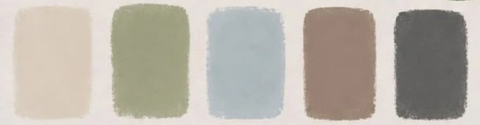

# Замена палитры Dress Code в GitHub Pages

В архиве полная версия проекта с новой палитрой. На действующем сайте, где ты уже дорабатывал CSS вручную, **не заменяй весь проект** — иначе личные правки `contrast.css` пропадут.

Для ручного обновления:

1. Добавь `assets/images/dress-code-palette.webp` в репозиторий.
2. В `index.html` удали старый `<div class="minimal-palette">...</div>` и подпись `<p class="palette-note">LA PALETTE DEL NOSTRO GIORNO</p>` над вкладками.
3. После закрывающего `</div>` блока `.looks` (после обеих панелей `.look-panel`, ПЕРЕД `</section>` Dress Code) вставь:

```html
<figure class="dress-palette-art" data-reveal>
  <figcaption class="palette-note">LA PALETTE DEL NOSTRO GIORNO</figcaption>
  
</figure>
```

4. В конец `assets/css/dress-code.css` скопируй новые правила `.dress-palette-art` из этого архива. Существующие стили `contrast.css` оставь как есть.
5. Нажми Commit changes и обнови страницу. На GitHub Pages иногда требуется немного подождать публикации.

Результат: палитра всегда следует после образов мужчин или женщин, независимо от выбранной вкладки.
